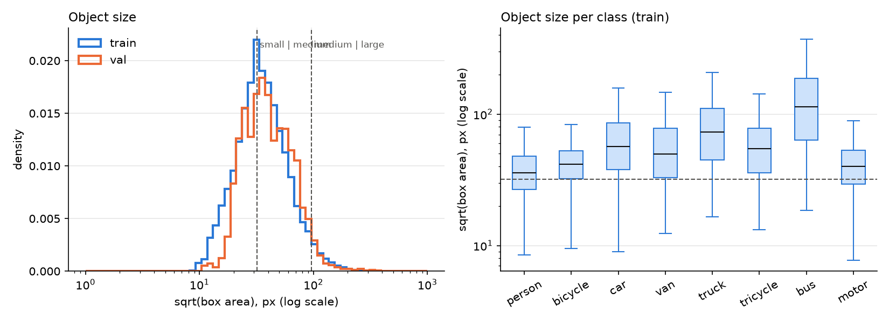
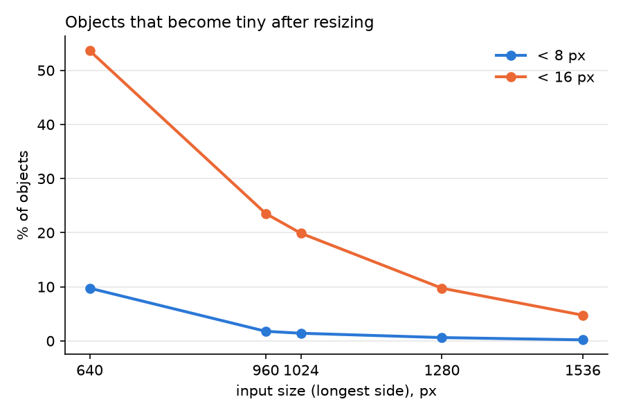
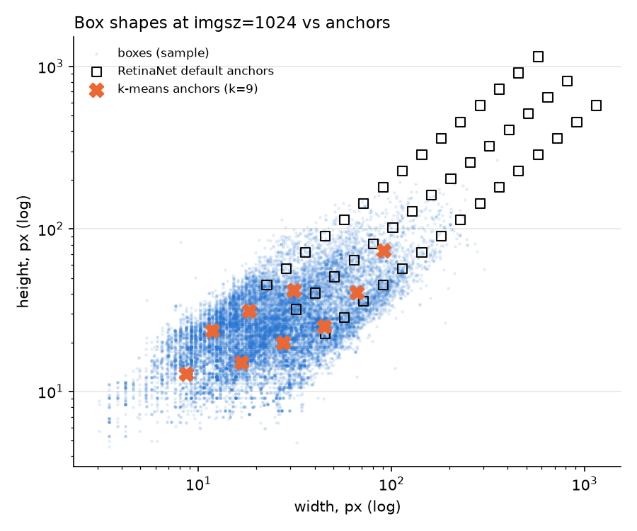
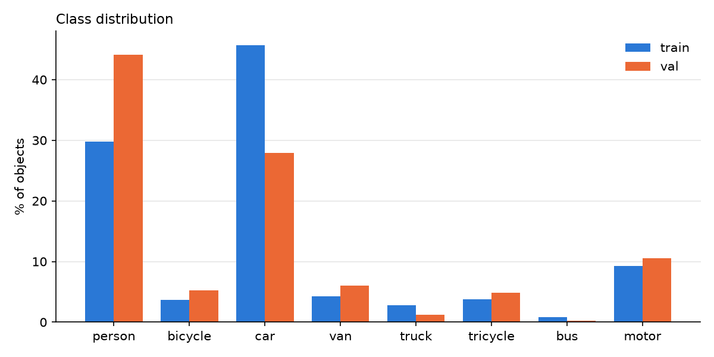
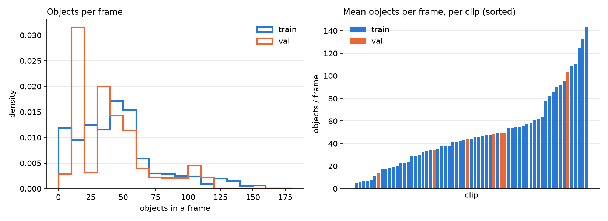
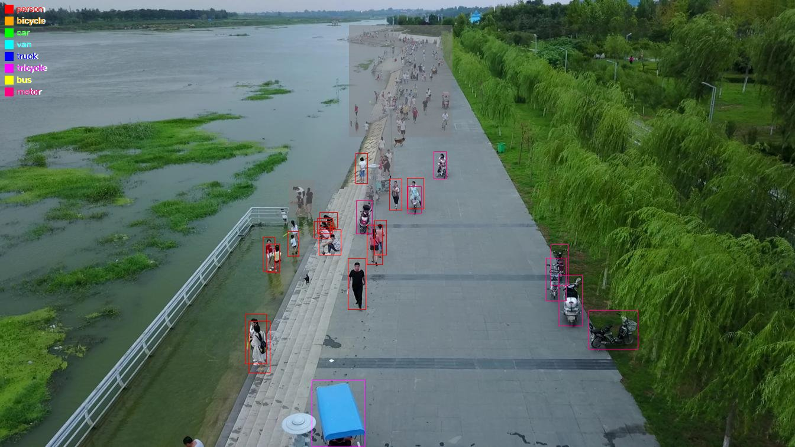
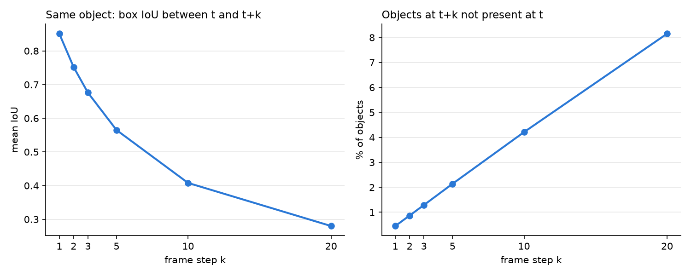
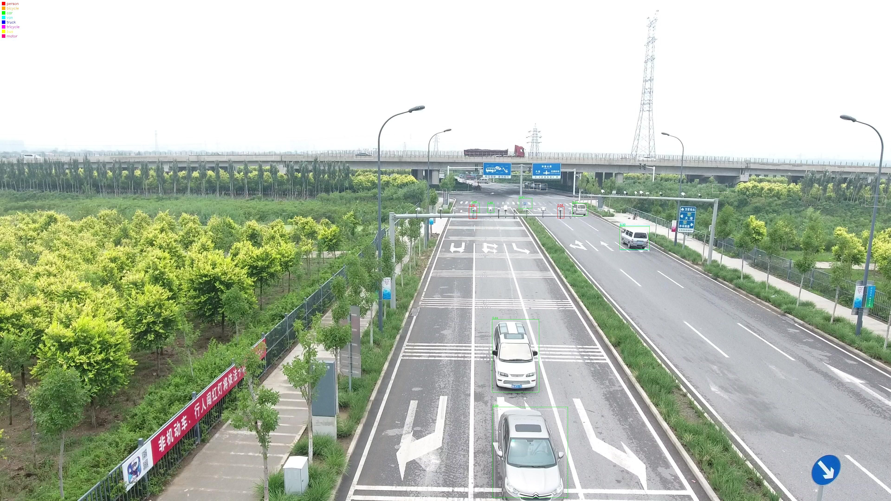
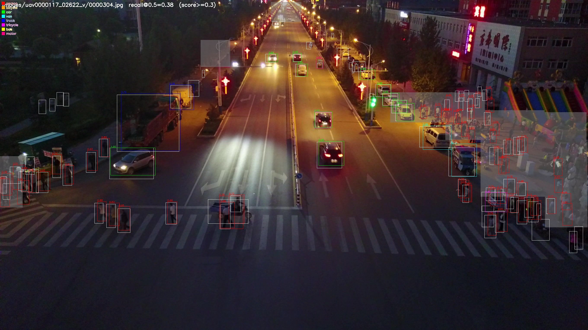
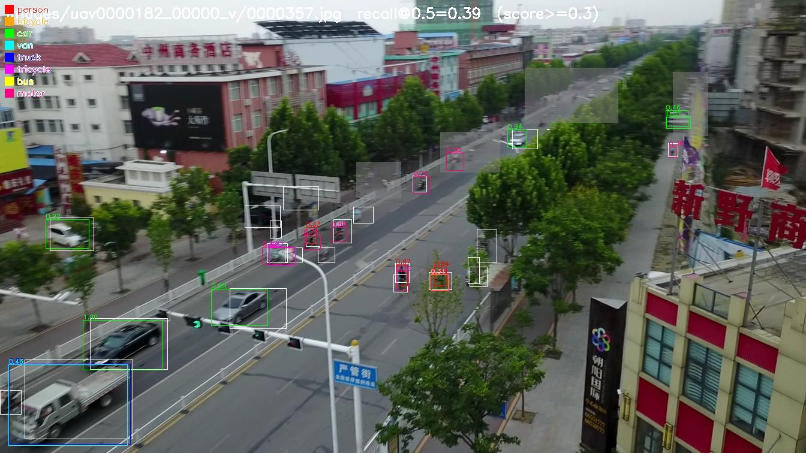

## 1. Introduction

Загалом наша задача є мульти детекшин об'єктів на фреймах окремих кліпів-відео.
Тобто ми маємо певну кількість відео, а вони складються із фреймів, і на кожному із фреймів ми можемо побачити об'єкти, і наша задача на кожному із фреймів незалежно побачити 8 класів об'єктів, кількість яких може бути довільна, але треба найти всі об'єкти що підпадають під статус одного із 8 класів і потім зрозуміти який то клас, після чого на кожному фреймі будуть квадратики із заголовками. А формат який ми здаємо це csv файл в якому на кожен фремй є список об'єктів які ми запредіктили, і для кожного об'єкта є такий спосіб позначення: ід класу(який із 8 класів), x, y(коорданати верхнього лівого пікселя що позначає край квадратика, що обводить об'єкт), w, h(висота та ширина відносно першого пікселя, що якраз обводить квадрат).

## 2. Setup and validation protocol (M0, M2)

### Setup
Загалом моя ідея сетапу: ми запускатимемо всі важкі скрипти за допомогою kaggle push та відповідно доступних 30 годин gpu від каглу. Для тестування скриптів я скачав частинку датасету що складається із 2 кліпів по 20 кадрів на кожен split (train, val, test). Також весь код ранитиметься і тестуватиметься на моєму CPU, аж поки не буде впевненості для того аби заливати код на кагл середовище після чого вже використовувати його ресурси. Також всі дані будуть доступними при виконання коду в kaggle середовищі, бо воно бачитиме лістинг компетішинів і матиме доступ до 10 Гб даних цього домашнього завдання.

Також для сетапу було обрано seed 42, який використовуватиметься для всіх запусків та експериментів.

Методикою показу результатів є те, що я просто стягуватиму код цього репо в колаб і там імпортуватиму функції написані тут для подальших дій із аналізу там датасету або навіть малого тренування, для показовості. Тож в результаті для кожного етапу згаданого як майлстоун в мене буде відповідний колаб що спочатку стягуватиме репо, братиме базову конфігурацію із yml файлів і потім просто імпортуватиме функції із репозиторію і все ранитиме, і може скачуватиме дані.

### Validation metrics
Для порівняння всіх моделей використовувався один і той самий оцінювач на основі pycocotools (`scripts/src/eval/coco_eval.py`). Усі метрики рахуються на повному val (2 846 кадрів), до 500 детекцій на кадр, поріг впевненості 0.001, інференс по одному кадру.

Що саме перевіряє кожна метрика:

- **mAP@[.5:.95]**: головна метрика. Для кожного класу будується крива precision–recall по ранжованих за впевненістю детекціях, AP — площа під нею; далі усереднення по 10 порогах IoU від 0.50 до 0.95 і по 8 класах. Через усереднення по IoU метрика карає не тільки пропущені об'єкти, а й неточно поставлені бокси; через усереднення по класах bus (0.9 % об'єктів) важить стільки ж, скільки car (45.7 %).
- **AP50**: та сама AP лише при IoU >= 0.5, тобто чи знайдено об'єкт узагалі, без вимоги точних меж. Різниця між AP50 і mAP показує, що саме кульгає: знаходження чи локалізація.
- **AP75**: при IoU >= 0.75, строга локалізація; корисна для порівняння двоетапних моделей, які мають окремий крок уточнення боксів.
- **AP_small / AP_medium / AP_large**: mAP окремо для об'єктів площею < 32^2, 32^2–96^2, > 96^2 px. Для цього датасету найважливіший AP_small: саме він перевіряє, чи допомогли `imgsz`, малі anchors і P2-head задетектити дрібні об'єкти (люди, мотоцикли).
- **AP по класах**: показує вплив диpбалансу класів і куди спрямовувати стратегії для рідкісних класів.
- **Швидкість**: кадрів за секунду на T4 при інференсі по одному кадру, плюс час тренування; це ціна, яку платимо за точність, і вона потрібна, щоб порівнювати моделі з різною кількістю параметрів чесно.

Окремо про ignore-регіони: вони додані в GT як `iscrowd=1` для кожного класу, тому детекція всередині такої зони не є ні true positive, ні false positive.

## 3. Data understanding and preprocessing (M1)

### Main points
Загалом для того аби почати аналізувати, треба зрозуміти що взагалі треба перевіряти. І для того треба зрозуміти як працюють деякі детективні моделі. І в нашому випадку ми маємо врахувати 3 моделі та їхні специфіки роботи, і відповідно після цього створити певні факти які варто перевірити, щоб уникнути ризиків певних.

В основному кожній моделі треба мати такі вимоги до малюнків, для того аби вона могла задетектити об'єкт, і я глобально виділив їх 7:
1. Моделька має бачити об'єкт: якщо в нас CNN перетворює 16 на 16 в 8 на 8, то якщо об'єкт менший за 8 пікселів, то фактично об'єкт для тої модельки як пів пікселя виглядає, і робити висновки з того неможливо
2. Сам механізм модельки метчиться із розмірами та формами самих об'єктів: наприклад в anchor базованих моделей, вони фокусуються на якомусь патерні об'єктів, але якщо в нас наприклад об'єкт в один момент має розміри там 32 пікселі, а в інший 8 пікселів(зменшився), а темплейт заметчився на 32 в середньому(бо нацбільше з 32 рпікселем форми було), то погано предіктити для тих самих об'єктів буде(саме для тої астки що кардинально відрізняється, тобто то треба також враховувати)
3. Є достатньо прикладів об'єктів із всіх класів, щоб темплейт генералізувався, бо якщо одного об'єкту мало, то його детекшин буде проблемою на валідації.
4. модель може намалювати максимально стільки боксів скільки є о'бєктів.
5. Модель вчиться на нормальних даних без тих, що не є позначеними, вони просто як на бекграунді як шум виглядають.
6. Валідація загалом має подібну поведінку до тої що вже була на тесті, тобто загалом test і val не сильно відрізняються по характеристиках і є подібними.
7. Загалом навчання відбувається на таких парах на яких кожна наступна має нову інформацію а не дублює попередню.
### Graphs and results
І для того аби перевірити ті всі поінти я створив такі то графіки:
1 поінт: малюнок eda_sizes.png

Загалом, щоб перевірити розкиданість і розміри об'єктів, я використав шкалу дисперсії об'єктів за їхніми коренями від площи, що вони охоплюють на зображенні. І від цього можна зрозуміти, що медіаною всіх таких об'єктів є 45.8 пікселів, 24.9% тобто чверть об"єктів є меншими за 32 пікселі. А також видно, що найменишими класами є person та motor, і загалом медіана їхня(площ на малюнку) є прям на рисці 32 пікселів, і також загалом bus та truck є найбільшими класами.

Другий графік показує, скільки об'єктів стає меншими за 16 px після ресайзу: 54 % при 640, 19.9 % при 1024, 9.7 % при 1280. І додатково видно зменшення відсотків об'єктів що мають розміри 8 px із збільшенням розмірів малюнків.

Через це я відкинув стандартний `imgsz=640` і зафіксував 1024 у протоколі, а 1280 запам'ятав для того аби розглядати його в майбутньому для покращення результату.

2 поінт: малюнок eda_anchors.png

Тут порівняно, наскільки стандартні anchors torchvision (від 32 до 512 px) накривають наші бокси, і що дає k-means по IoU: середній найкращий IoU 0.547 для стандартних проти 0.727 при k = 9. Тут просто навіть за точками видно що більшість боксів менші за найменший стандартний anchor (32 px); а натомість k-means дає розміри від 10 до 82 px.

Звідси рішення для anchor-based моделей: у Faster R-CNN і RetinaNet тестувати малі anchors 8/16/32/64/128 проти стандартних. І загалом можна також зрозуміти, що великим ботлнеком для anchor based моделей є якраз розмірність боксів об'єктів, тому тут набуває релевантності дивитись на такі модельки як YOLO, що не мають цього механізму і відповідно уникають цього ризику.

3 поінт: малюнок eda_classes.png

Видно дизбаланс: car 45.7 %, person 29.7 %, а bus лише 0.9 %. Val має подібні пропорції.

Через такий дизбаланс даних є сенс у фінальних метриках було додавати параметр AP по кожному класу, щоб бачити де просідає модель. Це загалом дало розуміння в необхідності тримати в планах oversampling/copy-paste для рідкісних класів.

4 поінт: малюнок eda_density.png

Середнє 45.7 об'єктів на кадр, медіана 43, максимум 180, найщільніші кліпи мають 110-143. Загалом це означає, що будь-який ліміт «100 детекцій» (дефолт COCO) ріже recall.

Через це в оцінювачі та інференсі стоїть 500 детекцій на кадр, для Faster R-CNN тестується 2000 proposals замість 1000, а для RT-DETR я відмітив, що 300 запитів при максимумі 180 об'єктів - запас невеликий.

5 поінт: малюнок gt_train_uav0000013_00000_v.jpg

Сірі зони - ignore-регіони (натовпи, парковки, накладні бокси з людьми); вони є в 74.75 % train-кадрів і займають у середньому 2.4 % площі. Усередині них машини реально є, але не марковані, тож для моделі це був би шум з машинами.

Тому в train ці зони зафарбовано сірим, а бокси, перекриті ними більш ніж на 50 %, видалено; в оцінюванні регіони додано як `iscrowd`, щоб детекції всередині не рахувались як помилки. Загалом я перевірив конвертацію знімків з додаваням індексів і тих зон, щоб перевірити чи часом не було розбіжностей із організаторами, як тільки я переконався в тому що все працює, то міг спокійно розуміти, що в мене правильно обробляються train інструкції.

6 поінт: порівняння train / val / test за попередніми графіками

Для цього поінта окремого графіка немає, бо достатньо подивитись на помаранчеві (val) криві на графіках попередніх поінтів. На `eda_sizes.png` розподіл розмірів val повторює train: той самий пік між 32 і 96 px, той самий лівий хвіст дрібних об'єктів, val лише трохи зсунутий у бік більших об'єктів. На `eda_classes.png` частки класів у val майже ті самі, що в train. На `eda_density.png` val-кліпи (помаранчеві стовпчики справа) розкидані по всьому діапазону щільності train - від 15 до 100 об'єктів на кадр, тобто hold-out не є ні «легшим», ні «важчим» за train по щільності; на лівій панелі видно лише, що у val більше кадрів з 10–20 об'єктами (один рідкий кліп) і є пік біля 100.

Отже, по всіх характеристиках, які можна виміряти за розміткою, val — репрезентативний зріз train, і для порівняння моделей між собою він підходить.

Для test розмітки немає, тому єдине, що можна порівняти це розмір кадрів із `test_images.csv`:

| split | кліпів | кадрів | довша сторона, медіана (діапазон) |
|---|---|---|---|
| train | 56 | 24 201 | 1904 (1344–2720) |
| val | 7 | 2 846 | 1904 (1344–3840, один 4K) |
| test | 48 | 3 811 | **1360 (680–1920)** |

І тут test відрізняється: його кадри в середньому на 30 % дрібніші, а найменші вдвічі менші за будь-який train-кліп. Оскільки об'єкти в дрібнішому кадрі теж дрібніші в пікселях, test фактично має більше «малих» об'єктів, ніж val, хоча сцени ті самі (дрони VisDrone).

Це підтвердилось на лідерборді: три YOLO-прогони мають майже однаковий val mAP (0.186 / 0.185 / 0.177), а на лідерборді - 0.212 (s, 1024), 0.211 (m, 1024) і 0.287 (s, 1280). Виграш дає лише `imgsz=1280`, і видно його тільки на test, бо саме тестові кадри (1360 px) при 1280 обробляються майже в оригіналі, а val-кадри (1904 px) все одно стискаються. Висновок: val із 7 кліпів не передбачив стрибка на public LB; але private-скори (baseline 0.195, 1280 - 0.192, RT-DETR 0.270) показали, що порядок моделей на val був правильним, а нетиповою була саме public-частина тесту.

7 поінт: малюнок eda_temporal.png

Для одного `track_id` IoU між сусідніми кадрами 0.85, а нових об'єктів лише 0.45 %; при кроці 10 - IoU 0.41 і 4.2 % нових. Тобто сусідні кадри майже дублюють один одного.

Звідси `frame_step=10` для train (2 446 кадрів замість 24 201, у 10 разів менше GPU-часу), а val - усі кадри, бо test оцінюється покадрово.

## 4. Detector families

### 4.1 Two-stage anchor-based: Faster R-CNN (M3)

Faster R-CNN це є двоетапний детектор: спочатку RPN (Region Proposal Network) по anchors на кожному рівні FPN відповідає лише на питання 'чи є тут якийсь об'єкт' і віддає приблизно 1000 кандидатів, а потім друга стадія вирізає ознаки кожного кандидата (RoIAlign, 7×7) і окремою головою визначає клас (8 + фон) та уточнює межі боксу.

| Experiment | anchors (px) | RPN proposals | RoI / img | mAP | AP50 | AP75 | AP_small | AP_medium | AP_large | bus | img/s (T4) | train | LB public / private |
|---|---|---|---|---|---|---|---|---|---|---|---|---|---|
| m3_frcnn_base (torchvision defaults) | 32-512 | 1000 | 512 | **0.212** | 0.427 | **0.184** | 0.092 | 0.195 | **0.388** | 0.042 | 6.5 | 25 min, 5 ep | **0.202 / 0.187** |
| m3_frcnn_small (k-means anchors) | 8-128 | 1000 | 512 | 0.204 | 0.430 | 0.170 | 0.090 | 0.190 | 0.368 | 0.053 | 6.8 | 25 min, 5 ep | 0.178 / 0.171 |
| m3_frcnn_rpn2000 (small anchors + 2x proposals) | 8-128 | 2000 | 512 | 0.198 | 0.424 | 0.163 | **0.099** | 0.183 | 0.358 | 0.031 | 6.0 | 25 min, 5 ep | 0.179 / 0.163 |

Сетап: `fasterrcnn_resnet50_fpn_v2` з torchvision, backbone ResNet-50 + FPN (рівні зі strides 4…64), ваги попередньо навчені на COCO; замінено лише фінальний класифікатор (9 виходів). Кадри ресайзяться так, щоб довша сторона = 1024 (як у протоколі), до 500 детекцій на кадр з порогом 0.001. Дані це той самий підготовлений train (`frame_step=10`, ignore-регіони зафарбовані), власний `Dataset` без вбудованих аугментацій torchvision, тому єдина аугментація - горизонтальний фліп (p = 0.5). Навчання: SGD (momentum 0.9, weight decay 1e-4), lr 0.005 для batch 4, warm-up 100 ітерацій + косинусне згасання,25 хв на T4, mixed precision. Інференс покадровий (batch 1), оцінювання тим самим COCO-оцінювачем, що й для YOLO.

Що тюнив і чому:
1. розміри anchors — за даними з розділу 3 (п. 2) 69 % боксів менші за найменший стандартний anchor 32 px, k-means дав діапазон 10–82 px, тому стандартні 32–512 замінено на 8–128; це напряму перевіряє, чи не бачить RPN дрібні об'єкти через шаблони.
2. Кількість proposals після NMS у RPN - за 4 поінтом у кадрі до 180 об'єктів, а стандартні 1000 кандидатів мають покрити їх усі з запасом на дублікати, тому перевірено 2000.
Faster R-CNN зі стандартними налаштуваннями виявився кращим за YOLO11s на val (0.212 проти 0.186) за рахунок точнішої локалізації (AP75) і великих об'єктів, але на лідерборді трохи програв (0.202 / 0.187 проти 0.212 / 0.195), а на дрібних об'єктах і в швидкості (6.5 проти 22.6 кадрів/с) програє всюди. Малі anchors і подвоєння proposals не допомогли ні на val, ні на LB (мінус 0.02-0.03 на public), тож для цього датасету вузьке місце Faster R-CNN - не шаблони, а recall RPN на дрібних об'єктах при 1024 px.
#### Failure cases

Кадр 1 (uav0000268_05773_v, кадр 322, recall 0.19). Модель знайшла три машини на передньому плані і кілька біля перехрестя, а всі машини на естакаді вгорі (білі бокси) пропустила повністю - там немає жодного передбачення. Біля перехрестя вона ще й поставила person (0.56, 0.58) на дорожні знаки і стовпи. Причина: об'єкти на естакаді по 10-20 px на сірому тлі парапету - RPN для них не видав кандидатів; а вузькі вертикальні стовпи за формою схожі на людину, і друга стадія їх так і класифікувала.

Кадр 2 (uav0000117_02622_v, кадр 304, recall 0.38). Машини на освітленій дорозі знайдено добре, а в натовпі праворуч біля атракціонів модель пропустила більшу частину людей, а ті, що знайшла, часто накриває одним боксом двох. Причини: ніч і темний тротуар - людей майже не видно; люди в натовпі перекривають одне одного, і NMS залишає один бокс на кількох.

Кадр 3 (uav0000182_00000_v, кадр 357, recall 0.39). Великі машини на передньому плані знайдено (car 0.99, 0.98), а на дорозі з деревами пропущено декілька об'єктів: мотоцикли розмиті та ті що за деревами, люди на тротуарі, машини біля дерев. Причина: кліп низької роздільної здатності (1344 px) і помітно розмитий через рух дрона, тому дрібні об'єкти в глибині просто не мають чітких країв.

### 4.2 One-stage anchor-based: RetinaNet (M4)

RetinaNet це одноетапний детектор: тут немає RPN і стадії уточнення, кожен anchor на кожному рівні FPN (strides 8...128) одразу класифікується в один з 8 класів і зсувається до об'єкта. Anchors тут виконують роль 'proposals', тому їх більше (9 на позицію: 3 розміри x 3 пропорції) і їхня відповідність реальним об'єктам важливіша, ніж у Faster R-CNN. Головна проблема такого підходу: на кадрі десятки тисяч anchors і лише десятки об'єктів, тому звичайна cross-entropy тоне в легких фонових прикладах; RetinaNet вирішує це focal loss, який зменшує вагу легких прикладів (alpha 0.25, gamma 2) і залишає градієнт від складних.

| Experiment | anchors (px) | topk / level | mAP | AP50 | AP75 | AP_small | AP_medium | AP_large | bus | img/s (T4) | train | LB public / private |
|---|---|---|---|---|---|---|---|---|---|---|---|---|
| m4_retina_small (k-means anchors) | 8-128 | 1000 | 0.056 | 0.174 | 0.022 | 0.031 | 0.051 | 0.107 | 0.001 | 7.5 | 25 min, 7 ep | 0.063 / 0.048 |

Сетап: `retinanet_resnet50_fpn_v2` з torchvision, той самий backbone ResNet-50 + FPN і ваги COCO, що й у Faster R-CNN, замінено лише класифікаційну голову (9 виходів, GroupNorm як у v2). Решта повністю збігається з 4.1: довша сторона 1024, до 500 детекцій на кадр, поріг 0.001, той самий підготовлений train і той самий `Dataset` з єдиною аугментацією (горизонтальний фліп), SGD з warm-up і косинусним згасанням, mixed precision, 25 хв на T4, покадровий інференс і той самий оцінювач. Відмінність одна: lr 0.0025 замість 0.005, бо focal loss на старті чутливіший до великого кроку.

Що тюнив і чому:
1. розміри anchors - одразу взяв k-means варіант 8-128 (3 масштаби на рівень: s, s*2^(1/3), s*2^(2/3)) замість стандартних 32-512, бо для одноетапної моделі anchors це єдиний механізм пошуку об'єктів і 69 % боксів менші за 32 px; прогін зі стандартними anchors не запускав через бюджет часу, тому ефект anchors оцінюю через порівняння з парою base/small у Faster R-CNN.
2. topk кандидатів на рівень FPN перед NMS залишив 1000 (при 5 рівнях це до 5000 кандидатів на кадр при максимумі 180 об'єктів), focal alpha/gamma залишив стандартними 0.25/2 - у torchvision вони зашиті в голову, і на їх перебір часу не було.

За той самий час 25 хвилин і той самий backbone RetinaNet дійшов лише до 0.056 на val і 0.063 на LB: класифікаційну голову довелося вчити з нуля для 8 класів, а без стадії proposals вона мусить сама відсіяти десятки тисяч фонових anchors на кадр, і 7 епох із обережним lr на це не вистачило. Порівняння з Faster R-CNN показує, що саме дає друга стадія - збалансовану вибірку для класифікатора, тому для щільних сцен з малим бюджетом навчання одноетапна anchor-based модель - найгірший вибір із чотирьох.
### 4.3 One-stage anchor-free: YOLO (M5)

YOLO11 це одноетапний детектор без anchors: на трьох рівнях FPN (strides 8, 16, 32) кожна клітинка сітки напряму передбачає 8 оцінок класів і 4 відстані до країв боксу, а який саме набір клітинок відповідає за об'єкт, під час навчання вирішує task-aligned assigner (клітинки, що одночасно близькі до центру об'єкта і вже добре його класифікують). Для дрібних і щільних сцен це означає, що немає шаблонів, які треба підбирати під розміри (ризик з поінту 2 зникає), але межа видимості об'єкта визначається кроком найдрібнішої сітки - 8 px, тому вхідний розмір кадру стає головним параметром.

| Experiment | model | imgsz | training | mAP | AP50 | AP75 | AP_small | AP_medium | AP_large | bus | img/s (T4) | LB public / private |
|---|---|---|---|---|---|---|---|---|---|---|---|---|
| m2_yolo_base | YOLO11s (9.4M) | 1024 | 10 epochs, 15 min | 0.186 | 0.376 | 0.162 | 0.103 | 0.183 | 0.292 | 0.011 | 22.6 | 0.212 / **0.195** |
| m7_m1024 | YOLO11m (20.1M) | 1024 | 1.5 h (time cap) | 0.177 | 0.350 | 0.155 | 0.108 | 0.172 | 0.286 | 0.045 | 38.6 | 0.211 / 0.189 |
| m7_s1280 | YOLO11s (9.4M) | 1280 | 1.5 h (time cap) | 0.185 | 0.374 | 0.159 | 0.102 | 0.188 | 0.267 | 0.008 | 37.6 | **0.287** / 0.192 |

Сетап: Ultralytics 8.4, ваги COCO (`yolo11s.pt` / `yolo11m.pt`), для 5 з 8 класів рядки класифікаційної голови перенесено з COCO за назвою. Той самий підготовлений train, але тут аугментації вбудовані: mosaic (4 кадри в один), фліп, hsv, масштабування; mosaic вимикається на останні 2-5 епох (`close_mosaic`), бо інакше при 10 епохах стандартне значення 10 вимкнуло б його взагалі. Оптимізатор і lr підбирає Ultralytics автоматично (AdamW), валідацію під час навчання вимкнено, щоб не витрачати GPU; інференс покадровий (batch 1) з conf 0.001 і max_det 500, оцінювач той самий. Довгі прогони обмежені часом (`time=1.5` год), Ultralytics сам вписує кількість епох і графік lr у цей час.

Що тюнив і чому:
1. вхідний розмір 1024 -> 1280 - за першим поінтом частка об'єктів менших за 16 px падає з 19.9 % до 9.7 %, а тестові кадри (медіана 1360 px) при 1280 обробляються майже без зменшення.
2. розмір моделі s -> m (9.4M -> 20.1M параметрів, 21.5 -> 68 GFLOPs) при тому ж 1024 - перевірка, чи обмежує результат ємність моделі, а не пікселі.
3. тривалість навчання 10 епох -> змінено до кількості епох в період часу 1.5 год в обох тюнених прогонах.

Результат: на val усі три прогони майже однакові (0.177-0.186), тобто ні довше навчання, ні більша модель на hold-out нічого не дали; більша модель лише підняла найрідший клас bus (0.011 -> 0.045). На лідерборді картина інша: 1280 дає 0.287 проти 0.212 і 0.211, тобто весь виграш від вхідного розміру, і він видно тільки на дрібніших тестових кадрах (п. 6). AP_large при 1280 трохи впав (0.292 -> 0.267): найбільші об'єкти виходять за зручний діапазон stride-32 голови.

При тому самому imgsz 1024 і тих самих даних YOLO11s (15 хв) проти Faster R-CNN (25 хв): дрібні об'єкти краще у YOLO (AP_small 0.103 проти 0.092), середні й великі - у Faster R-CNN (0.183/0.292 проти 0.195/0.388), локалізація точніша у Faster R-CNN (AP75 0.162 проти 0.184). Тобто anchor-free голова зі stride 8 краще ловить дрібне, а друга стадія краще дотягує бокси великого. Швидкість: 22.6 проти 6.5 кадрів/с. RetinaNet при цьому бюджеті не конкурент (0.056).

### 4.4 Query-based: RT-DETR (M6)

RT-DETR це детектор на трансформері: backbone дає ознаки, а декодер має фіксований набір з 300 learnable queries, кожен з яких 'забирає' собі один об'єкт. Під час навчання запити зіставляються з об'єктами один-до-одного (Hungarian matching), тому модель одразу вчиться не дублювати детекції і NMS їй не потрібен. Для щільних сцен це плюс (NMS у щільному натовпі видаляє сусідів), але кількість об'єктів обмежена кількістю запитів: у нас максимум 180 на кадр при 300 запитах.

| Experiment | model | imgsz | queries | training | mAP | AP50 | AP75 | AP_small | AP_medium | AP_large | bus | img/s (T4) | LB public / private |
|---|---|---|---|---|---|---|---|---|---|---|---|---|---|
| m6_rtdetr | RT-DETR-L (COCO) | 1024 | 300 | 45 min cap | **0.252** | **0.493** | **0.225** | **0.139** | **0.226** | **0.425** | **0.172** | 16.0 | **0.340 / 0.270** |

Сетап: Ultralytics 8.4, `rtdetr-l.pt` (ваги COCO, backbone HGNetv2), той самий скрипт і ті самі дані, що й для YOLO (підготовлений train, mosaic з вимкненням на останні 2 епохи, auto-оптимізатор), batch 4 через пам'ять трансформера при 1024, бюджет 0.75 год. Інференс покадровий, без NMS (модель видає до 300 боксів з оцінками, далі поріг 0.001 і ліміт 500). Оцінювач той самий.

Що тюнив: нічого, окрім бюджету часу - прогін один, бо на перебір кількості запитів (треба правити yaml моделі) і lr backbone часу не залишилось.

RT-DETR виявився найкращою моделлю за всіма трьома мірками - val 0.252, public 0.340, private 0.270 - і кращим у кожному розрізі: дрібні об'єкти, великі, локалізація і особливо рідкісний клас bus (0.172 проти 0.01-0.05 в інших), при швидкості 16 кадрів/с між YOLO і Faster R-CNN.

## 5. Final pipeline (M7)

На момент фінального сабміту (дедлайн Kaggle) у мене була перевірена на test лише одна модель - YOLO11s baseline з розділу 2 (val 0.186, LB 0.212, нижче за baseline організаторів 0.222). Faster R-CNN, RetinaNet і RT-DETR я запускав уже після дедлайну, тому їх у виборі фіналу не було. Тож пайплайн я будував не як 'найкраща модель з розділу 4 плюс покращення', а як 'baseline плюс виправлення його двох виміряних слабких місць': недовчений (10 епох, 15 хв) і погано бачить дрібні об'єкти (AP_small 0.103 проти AP_large 0.292). Це дало два кандидати, що міняють по одній речі, і час вирішив, який з них став фіналом.

| Step | Change | val mAP | AP_s | AP_l | bus | LB |
|---|---|---|---|---|---|---|
| 0 | YOLO11s, imgsz 1024, 10 epochs (baseline, Sec. 2) | 0.186 | 0.103 | 0.292 | 0.011 | 0.212 |
| 1a | те саме + imgsz 1280 + навчання 1.5 год (time cap), close_mosaic 5 | 0.185 | 0.102 | 0.267 | 0.008 | **0.287** |
| 1b | YOLO11m (більша модель) + imgsz 1024 + 1.5 год | 0.177 | 0.108 | 0.286 | 0.045 | 0.211 |

(a) Дані та інференс. Дані ті самі, що й для всіх моделей: frame_step 10, ignore-регіони зафарбовані. Аугментація - стандартна з Ultralytics, я її не міняв: mosaic (4 кадри склеюються в один, що дає більше об'єктів і контекстів на батч), горизонтальний фліп, зсув кольору hsv, випадкове масштабування; mosaic вимикається на останні 5 епох, щоб модель довчилась на звичайних кадрах, схожих на test. Головна зміна в інференсі - вхідний розмір 1280 замість 1024: за розділом 3 частка об'єктів менших за 16 px падає з 19.9 % до 9.7 %, а тестові кадри (медіана 1360 px) при 1280 обробляються майже без зменшення. Tiling, TTA і Soft-NMS не пробував - не було часу перевірити їх на val до дедлайну.

(b) Модель. Два варіанти: та сама YOLO11s, але довше (1a), або вдвічі більша YOLO11m (1b). Навчання обмежував часом (`time=1.5` год), Ultralytics сам вписує кількість епох і графік lr у бюджет - це гарантувало, що прогін закінчиться до дедлайну незалежно від швидкості епохи. Кандидат 1b застряг у черзі Kaggle і закінчився вже після дедлайну, тому фіналом став 1a.

Як обирав. На val обидва кандидати не кращі за baseline (0.185 і 0.177 проти 0.186), і якби я обирав тільки по val, фіналом лишився б baseline з LB 0.212. Обрав 1a, бо це єдиний кандидат, який прямо відповідав на виміряну слабкість (пікселі на дрібних об'єктах) і на різницю між val і test по роздільній здатності. На лідерборді він дав 0.287 проти 0.211 у 1b, тобто весь виграш - від вхідного розміру, а не від довшого навчання і не від розміру моделі. Другим фінальним сабмітом залишив baseline як запасний варіант.

Після закриття змагання стало видно private-скори: фінальний 1280 дав 0.192, стільки ж, скільки baseline (0.195), а RT-DETR - 0.270. Тобто виграш 1280 був особливістю public-кліпів, а val (0.185 проти 0.186) чесно показував, що моделі рівні.

Що б я робив далі, виходячи з розділу 4: RT-DETR на val кращий за YOLO на 0.066 і особливо на дрібних об'єктах і bus, тож наступний крок - RT-DETR на 1280, а далі ансамбль (WBF) YOLO-1280 і RT-DETR, оскільки вони помиляються по-різному (YOLO краще на дрібному, Faster R-CNN/RT-DETR - на великому і рідкісних класах).

## 6. Summary of all models

| Model | mAP | AP50 | AP_s | img/s (T4) | LB public / private |
|---|---|---|---|---|---|
| Faster R-CNN (defaults, best of 3) | 0.212 | 0.427 | 0.092 | 6.5 | 0.202 / 0.187 |
| RetinaNet (k-means anchors) | 0.056 | 0.174 | 0.031 | 7.5 | 0.063 / 0.048 |
| YOLO11s (1024, baseline) | 0.186 | 0.376 | 0.103 | 22.6 | 0.212 / 0.195 |
| RT-DETR-L (1024) | **0.252** | **0.493** | **0.139** | 16.0 | **0.340 / 0.270** |
| Final pipeline (YOLO11s, 1280) | 0.185 | 0.374 | 0.102 | 37.6 | 0.287 / 0.192 |

Найбільше дав не підбір гіперпараметрів, а зміна сімейства моделі: RT-DETR з його зіставленням один-до-одного без NMS виграв у всіх розрізах, особливо на дрібних об'єктах і рідкісному класі bus, тоді як anchors, proposals, розмір YOLO і довше навчання в межах 25-90 хвилин не зрушили val узагалі. З передбачень розділу 3 справдились дрібні об'єкти як головна проблема (AP_s удвічі нижчий за загальний mAP у всіх моделей) і дизбаланс класів (bus найгірший усюди), а от ставка на малі anchors не підтвердилась - RPN Faster R-CNN і так пропонує дрібне, вузьке місце в пікселях, а не в шаблонах.

## 7. Unsuccessful attempts

- Малі anchors 8-128 у Faster R-CNN (4.1): val 0.204 проти 0.212 зі стандартними, LB 0.178 проти 0.202. RPN FPN v2 працює від stride 4 і дрібні об'єкти пропонує і так; вузьке місце в пікселях після ресайзу, а не в шаблонах.
- 2000 proposals замість 1000 (4.1): AP_small трохи виріс (0.099), але загальний mAP впав (0.198): при тих самих 512 RoI друга стадія отримує більше фону.
- RetinaNet за 25 хв (4.2): 0.056 - класифікаційна голова з нуля без стадії proposals не встигла навчитись; треба щонайменше годину і перевірку стандартних anchors.
- YOLO11m замість YOLO11s (4.3, 5): val 0.177, LB 0.211 / 0.189 - більша модель не допомогла, лише підняла bus; ємність не була обмеженням.
- Довше навчання YOLO (1.5 год замість 15 хв): val не зріс (0.185 проти 0.186) - з frame_step 10 модель бачить 56 сцен, і більше епох їх лише запам'ятовує.
- Вибір фіналу по public LB: 1280 дав 0.287 на public і 0.192 на private; val ранжував правильно, а я йому не повірив.

## 8. Final model and run instructions

- **Код (GitHub):** https://github.com/BodiyaKol/ucu-ai-hm-2-object-detection_Kolodchak (усе в папці `code/`, інструкції - [`code/README.md`](https://github.com/BodiyaKol/ucu-ai-hm-2-object-detection_Kolodchak/blob/main/code/README.md))
- **Запустити самостійно в Google Colab:**  - ноутбук `final_rtdetr_walkthrough.ipynb` відкривається прямо з репозиторію, достатньо Runtime -> Run all.

Обрана модель - RT-DETR-L (`configs/rtdetr/base.yaml`, ваги COCO `rtdetr-l.pt`, imgsz 1024, 300 запитів, 45 хв на T4), val mAP 0.252, LB 0.340 public / 0.270 private. Фінальний сабміт до дедлайну був YOLO11s на 1280 (`configs/yolo/final_s1280.yaml`), бо RT-DETR не встиг.

Покроковий ноутбук `code/notebooks/final_rtdetr_walkthrough.ipynb` проходить увесь пайплайн на mini-датасеті (CPU, ~5 хв): клонує репо, ставить `code/requirements.txt`, запускає `scripts/prepare_data.py`, показує конфіги, запускає `scripts/train_yolo.py --mini --config configs/rtdetr/base.yaml` (train -> val COCO eval -> submission.csv + перевірка формату) і в кінці дає команди для Kaggle. Повний прогін - kernel `notebooks/06_rtdetr/` (`kaggle kernels push -p notebooks/06_rtdetr --accelerator NvidiaTeslaT4`), інференс із збережених ваг - `notebooks/08b_late_rtdetr/`. Seed 42 скрізь, `deterministic=True`, інференс покадровий. Результати всіх прогонів лежать у `code/results/*.json` і `code/experiments.md`; інструкції з запуску - у `code/README.md`.

## 9. Conclusion

- Перед моделями варто розібратись, чого кожне сімейство детекторів вимагає від даних, і перевірити це на цифрах: 7 поінтів розділу 3 визначили майже всі подальші рішення.
- Навчився вести проєкт через власний сетап: один оцінювач і один формат передбачень для всіх моделей, mini-датасет для перевірки на CPU, Kaggle kernel'и з обмеженням по часу, збережені ваги для повторного інференсу - без цього половина прогонів не дожила б до результату.
- Одна зміна дає результат лише тоді, коли закриває конкретну виміряну слабкість: для одноетапної YOLO дрібні об'єкти були найслабшим місцем, і саме збільшення роздільної здатності до 1280 підняло public LB з 0.212 до 0.287, тоді як більша модель і довше навчання не дали нічого.
- Познайомився на практиці з усіма чотирма сімействами - двоетапним Faster R-CNN, одноетапними RetinaNet і YOLO, query-based RT-DETR - і побачив, що вибір сімейства важить більше за гіперпараметри: RT-DETR без NMS виявився найкращим на val і на обох частинах лідерборду.

## References

1. Ultralytics YOLO11 / RT-DETR, версія 8.4.214. https://github.com/ultralytics/ultralytics - навчання та інференс YOLO і RT-DETR (4.3, 4.4, 5).
2. torchvision 0.29 (`fasterrcnn_resnet50_fpn_v2`, `retinanet_resnet50_fpn_v2`). https://pytorch.org/vision - моделі 4.1, 4.2.
3. pycocotools 2.0.11. https://github.com/cocodataset/cocoapi - COCO-оцінювач (`scripts/src/eval/coco_eval.py`).
4. Kaggle API. https://github.com/Kaggle/kaggle-api - запуск kernel'ів з терміналу, завантаження виходів, сабміти (розділи 2, 8).
5. Сторінка змагання: Multiple Object Video Detection | HW2 | UCU AI 2026. https://www.kaggle.com/competitions/multiple-object-video-detection-hw-2-ucu-ai-2026 - формат даних, submission.csv, правила оцінювання.

Код у репозиторії написаний у межах цієї роботи з допомогою AI-асистента (Claude) як інструмента для написання коду; усі рішення, експерименти і текст звіту - мої.
